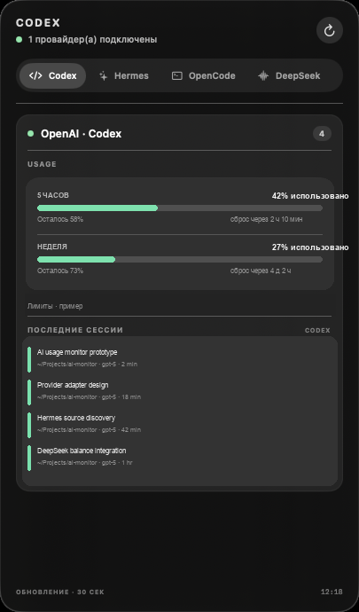
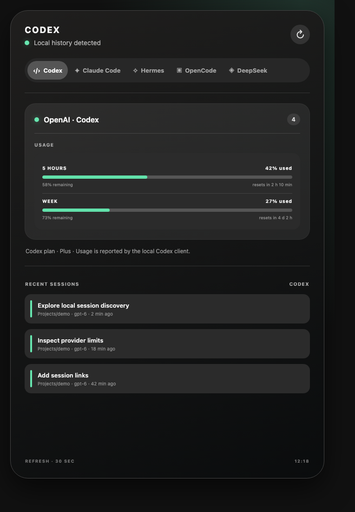
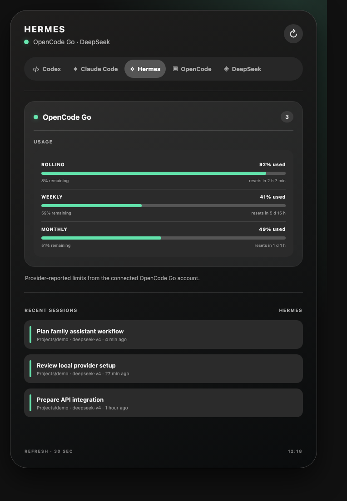
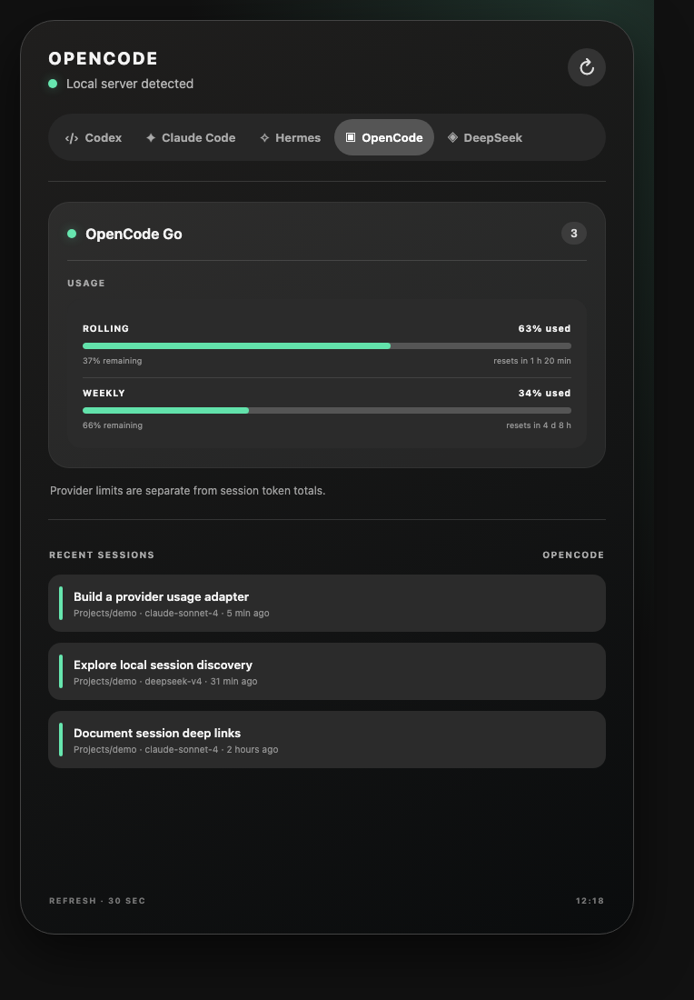
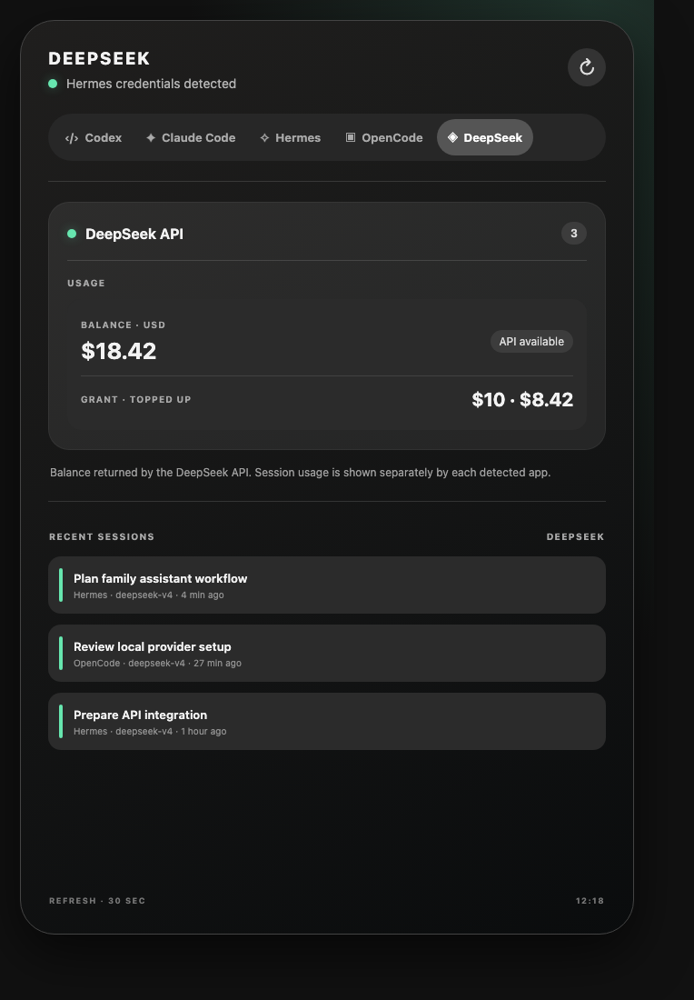

# AI Usage Monitor for macOS

Desktop panel for recent sessions and provider usage from local AI coding agents. The v0.1 client is a native macOS app. Its session and provider adapters are kept separate from the view so additional agents can be added without changing the app model.



The screenshot uses synthetic session names and token totals. It contains no account data or local history.

<details>
<summary>More app screenshots</summary>









</details>

## Supported sources

| Source | Automatic discovery | Data shown | Session link | Local verification |
| --- | --- | --- | --- | --- |
| Codex | CLI in common install paths or `PATH`; newest `~/.codex/state_*.sqlite` | Recent threads; 5-hour and weekly limits from local rollout events | `codex resume <thread-id>` in Terminal | Verified: sessions and limits |
| Claude Code | CLI in common install paths or `PATH`; `~/.claude/projects/**/*.jsonl` | Recent saved sessions; input, output, and cache token totals from local transcripts | `claude --resume <session-id>` in Terminal | Detected: 3 transcripts; no account quota |
| Hermes | CLI and `~/.hermes/state.db` | Recent sessions grouped by `billing_provider` | `hermes --resume <session-id> chat` in Terminal | Verified: sessions and DeepSeek balance |
| OpenCode | CLI in common install paths or `PATH`; its local API | Recent sessions, model, provider, token counts, and cost when provided | Opens `opencode --session <id>` in the project directory | Verified: sessions |
| OpenClaw | CLI in common install paths or `PATH` | `sessions --all-agents --json`; provider quota snapshots from `status --usage --json` | Opens `openclaw tui <session-key>` | Unverified: CLI unavailable locally |
| DeepSeek | Hermes provider credentials | Official API balance plus session-derived token and cost totals | Shows matching sessions from detected agents | Verified: API balance and session totals |
| OpenCode Go | Hermes provider credentials and usage adapter | Provider-reported rolling, weekly, and monthly limits | Shows matching Hermes/OpenCode sessions | Adapter ran; account returned HTTP 401 |

Local verification was performed on macOS on 2026-11-10. The Claude Code CLI was present and its adapter read three local transcripts; this verifies session and transcript parsing, not Anthropic account usage. OpenClaw is not installed here, so its adapter has not been exercised against a live installation. The Hermes and OpenCode session readers work; the configured OpenCode Go account currently returns HTTP 401, while the DeepSeek balance adapter returns account data. Sessions remain visible when their provider has no usage adapter, with an unavailable status instead of an invented quota. The OpenClaw adapter follows the documented [sessions JSON](https://docs.openclaw.ai/cli/sessions), [usage JSON](https://docs.openclaw.ai/cli/status), and [TUI session target](https://docs.openclaw.ai/cli/tui) interfaces.

## Install from source

Requirements: macOS 14 or later and Xcode Command Line Tools. Provider CLIs are optional; only installed sources appear with data.

```sh
git clone https://github.com/alexzrn/ai-usage-monitor-macos.git
cd ai-usage-monitor-macos
./build.sh
open "build/AI Usage Monitor.app"
```

The app uses SwiftUI and AppKit. It refreshes every 30 seconds by default. Right-click the panel to refresh, choose 15/30/60/120-second intervals, or quit. Session rows open the corresponding local CLI in Terminal; selecting a row does not send a prompt.

## Language

The interface follows the macOS preferred language: Russian and Simplified Chinese are supported. English is the default for all other languages. Product names, model names, and provider names remain in their original form.

## Discovery and extension

`Resources/registry.json` defines app tabs and known provider relationships. Collectors inspect only documented local stores and installed CLIs. Provider IDs found in session metadata are added to that app's tab automatically. New agents need a session collector; new provider quota sources need a usage adapter. See [`docs/architecture/platforms.md`](docs/architecture/platforms.md) for the platform scope and expansion path.

The current release targets macOS only and is named accordingly. Windows and Linux need their own desktop shell and local-source adapters. Linux DE support will require separate integration choices (for example, a KDE Plasma widget or GNOME Shell extension); the macOS SwiftUI panel cannot run there.

## Privacy and limitations

- Session titles, project paths, models, token counts, and costs are read locally.
- DeepSeek balance requests go directly from this Mac to the DeepSeek API. The key is resolved from Hermes and is neither displayed nor saved by this app.
- The app sends no telemetry.
- Some providers expose only quota windows or balances, not complete historical spend. Session-derived totals are labeled separately from provider-reported values.
- A public source repository is provided without an open-source license.

## Contributing

Contributions are welcome. If you have OpenClaw or another supported agent installed, please check session discovery, usage, and session links on your setup and report what works. Testing additional agents is welcome too. Open an issue with the OS, app and CLI versions, and a sanitized result; do not include API keys, prompts, personal session history, or screenshots containing private data. Pull requests should document the local files or official interface used, keep provider-reported limits separate from session totals, and include English, Russian, and Simplified Chinese strings for new UI.

Build locally with `./build.sh` on macOS 14 or later. Before opening a pull request, confirm the app builds and that the affected source is represented in the README support table.

## Русский

Нативная панель macOS для сессий локальных coding-агентов и Usage их провайдеров. Версия автоматически обнаруживает Codex, Claude Code, Hermes, OpenCode и OpenClaw по локальным CLI и базам. Для Claude Code usage считается по сохранённым локальным транскриптам и не является квотой Anthropic. Провайдеры определяются по метаданным сессий. DeepSeek подключается через credentials Hermes. Интерфейс выбирает русский или упрощённый китайский по языку macOS; для остальных языков используется английский.

Сборка: macOS 14+, Xcode Command Line Tools, затем `./build.sh`. Приложение обновляет данные раз в 30 секунд; интервал можно изменить в контекстном меню. Нажатие на сессию открывает соответствующий CLI с её ID или ключом и не отправляет запрос модели.

Язык интерфейса выбирается по системному языку macOS: русский и упрощённый китайский поддерживаются, английский используется по умолчанию. Текущий выпуск поддерживает только macOS. Для Windows и Linux понадобятся отдельные оболочки и адаптеры системных источников; Linux-интеграция будет учитывать выбранную DE.

Локальная проверка на macOS (10 ноября 2026): Codex показывает сессии и лимиты; Hermes и OpenCode читают сессии; баланс DeepSeek получен через API. Claude Code CLI обнаружен, адаптер прочитал три локальных транскрипта — квота Anthropic при этом не проверяется. OpenClaw локально не установлен и на живой системе не проверен. Usage OpenCode Go сейчас отвечает HTTP 401.

Если у вас установлен OpenClaw или другой агент, проверьте обнаружение сессий, Usage и переход к сессии. Будем рады проверке других агентов и форматам источников. В issue укажите ОС, версии приложения и CLI, а результат обезличьте: не публикуйте ключи, prompts, личную историю и скриншоты с приватными данными.

Скриншот демонстрационный: названия сессий и лимиты вымышлены. Баланс, API-ключи и личная история в репозиторий не включены.
